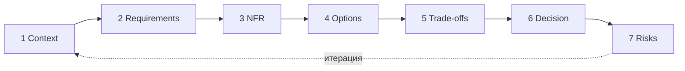

# Сессия 1. Роль архитектора и framework

Шаги framework: все (обзор).

## Зачем

Сильный инженер получает задачу и сразу начинает строить решение. Для компонента это работает. Для решения целиком это опасно: можно хорошо построить не то. Сессия меняет первый вопрос: с «как построить» на «что строим, зачем и чем за это платим».

## Ключевые идеи

### 1. Меняется вопрос, не уровень знаний

| | Senior / lead инженер | Solution architect |
|---|---|---|
| Первый вопрос | Как это построить? | Что и зачем строим? Чем платим? |
| Вход | Задача с понятными границами | Проблема бизнеса, границы не заданы |
| Критерий успеха | Работает, код хороший | Решает проблему бизнеса при заданных constraints |
| Горизонт | Спринт, релиз | Годы эксплуатации и изменений |
| Главный risk | Плохая реализация | Хорошая реализация неверного решения |
| Результат | Код | Решения и их причины |

Вывод: архитектор не «самый сильный программист». Это другая работа.

### 2. Архитектура = решения, которые дорого менять

Чёткой границы между архитектурой и дизайном нет. Есть шкала.

| Вопрос к решению | Ближе к архитектуре | Ближе к дизайну |
|---|---|---|
| Сколько стоит изменить позже? | Дорого | Дёшево |
| Сколько команд и компонентов затронет? | Несколько | Один |
| Влияет на NFR системы? | Да | Нет или локально |
| Кто должен знать о решении? | Stakeholders | Команда |

Пример: «синхронный вызов или очередь между двумя системами» — архитектура. «Какой класс отвечает за retry» — дизайн.

Следствие: время архитектора ограничено. Тратить его надо на дорогие решения. Дешёвые решения оставить команде.

### 3. Всё есть trade-off

- Лучшего решения нет. Есть решение с приемлемой ценой для этого контекста.
- Вы не видите цену решения → вы её ещё не нашли. Ищите дальше.
- Ответ на вопрос «что лучше, A или B?» всегда начинается с «зависит от…». Работа архитектора — назвать, от чего именно.

| Плохая формулировка | Хорошая формулировка |
|---|---|
| «Берём микросервисы, это современно» | «Берём микросервисы: 5 команд должны релизить независимо. Платим сложностью эксплуатации и распределёнными транзакциями» |
| «Kafka надёжнее» | «Очередь развязывает системы по времени. Платим: итоговая консистентность, новый компонент в эксплуатации» |

### 4. «Почему» важнее, чем «как»

Диаграмма показывает, как система устроена. Она не показывает, почему выбран этот вариант и какие варианты отклонены. Через год причину не помнит никто, и решение или ломают, или боятся трогать.

Правило: решение без записанной причины = решение не принято. Формат записи (ADR) — сессия 9.

### 5. Requirements выбирают архитектуру, не технологии

Не каждый requirement влияет на архитектуру. Те, которые влияют, называются ASR (architecturally significant requirements). Как их найти — сессия 2.

### 6. Framework: 7 шагов

| # | Шаг | Главный вопрос |
|---|---|---|
| 1 | Context | Кто, зачем, в каких границах? |
| 2 | Requirements | Что система должна делать? Что влияет на архитектуру? |
| 3 | NFR | Насколько хорошо? В цифрах |
| 4 | Options | Какие 2–3 решения возможны? |
| 5 | Trade-offs | Что получаем и что теряем в каждом варианте? |
| 6 | Decision | Что выбираем и почему? |
| 7 | Risks | Что может сломаться? Чего мы не знаем? |

Правила применения:

- Шаги 1–3 = пространство проблемы. Шаги 4–7 = пространство решения. Не переходить к шагу 4, пока нет ответа на шаги 1–3.
- Это не waterfall. Шаг 5 часто показывает дыру в шаге 3. Вернуться назад — нормально.
- Минимум два варианта на шаге 4. Один вариант = нет выбора = нет trade-off анализа.
- Framework масштабируется: 15 минут у доски или 2 недели на большой проект. Шаги те же.

## Пример: Data Engineering

Запрос: «Постройте streaming на Kafka, нужны данные в реальном времени».

Инженер начинает выбирать движок обработки. Архитектор спрашивает: какое решение бизнеса зависит от свежести данных? Ответ: отчёт, который читают утром раз в день. Тогда ночной batch дешевле, проще и закрывает потребность. «Реальное время» было решением, не requirement.

## Типовые ошибки

| Ошибка | Почему возникает | Что делать |
|---|---|---|
| Начать с технологии | Технологии — зона уверенности инженера | Сначала шаги 1–3. Технологию называть только на шаге 4 |
| Один вариант | Первый вариант кажется очевидным | Заставить себя описать второй. Сравнить честно |
| Называть только плюсы | Хочется защитить своё решение | Для каждого решения назвать цену вслух |
| Принять запрос как requirement | Заказчик формулирует в виде решения | Спросить «зачем?» до уровня бизнес-результата |
| Проектировать всё одинаково глубоко | Привычка к полноте | Глубоко — дорогие решения. Остальное — команде |
| Не записать причину | «И так понятно» | Записать: контекст, выбор, отклонённые варианты |

## Вопросы для обсуждения

1. Вспомните решение в вашем проекте, которое сейчас очень дорого изменить. Кто и как его принял? Понимали ли тогда цену?
2. Какое недавнее ваше техническое решение было архитектурным, хотя вы считали его дизайном?
3. Назовите решение, которое вы считаете «просто лучшим», без минусов. Найдём цену вместе.
4. Когда вы последний раз получили задачу в виде готового решения? Что было настоящей проблемой?
5. Сколько вариантов вы обычно рассматриваете? Что мешает рассматривать больше?
6. Где в вашем проекте записаны причины главных решений? Что будет, если вы уйдёте?

## Задание на сквозной кейс

1. Прочитать описание сквозного кейса.
2. Записать первое решение, которое пришло в голову. Отложить.
3. Записать 5–7 вопросов заказчику, без ответов на которые проектировать нельзя.
4. Для отложенного решения назвать 2 цены, которые за него придётся заплатить.

Результат обсуждаем в начале сессии 2.

## Чтение

Обязательное:

- *Fundamentals of Software Architecture* (Richards, Ford) — вводные главы: определение архитектуры, законы архитектуры, архитектурное мышление.

Дополнительное:

- *Software Architecture: The Hard Parts* (Ford и др.) — вводная глава: почему нет «best practices», есть только trade-offs.
