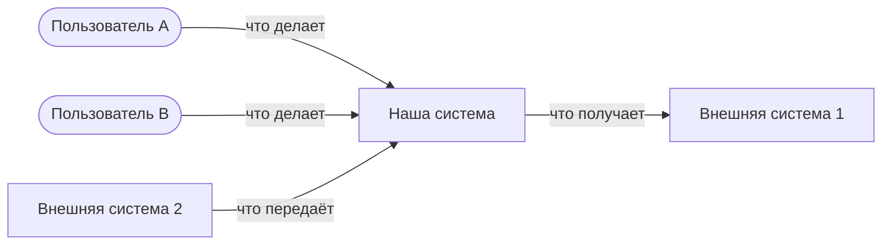

# Сессия 2. Context и business requirements

Шаги framework: 1 Context, 2 Requirements.

## Зачем

Инженер привык получать requirements готовыми. Архитектор их добывает: requirements неполные, противоречивые и часто записаны как решения. Сессия учит собрать context и выделить те немногие requirements, которые определяют архитектуру.

## Ключевые идеи

### 1. Сначала проблема, потом система

Шаблон problem statement (4 строки, без технологий):

| Строка | Вопрос |
|---|---|
| Для кого | Кто испытывает проблему? |
| Проблема | Что сейчас плохо? Сколько это стоит? |
| Изменение | Что станет иначе после решения? |
| Мера | По какому числу поймём, что получилось? |

Проверка: в тексте есть название технологии или слово «система должна» → это уже решение. Переписать.

### 2. Stakeholders: у каждого своя система

| Stakeholder | Что волнует | Что спросить |
|---|---|---|
| Спонсор / бизнес-владелец | Результат, срок, бюджет | Что будет, если не сделать? Что важнее: срок или объём? |
| Пользователи | Удобство, скорость, доступность | Как работаете сейчас? Где теряете время? |
| Эксплуатация | Стабильность, мониторинг, поддержка | Кто дежурит? Что умеете сопровождать? |
| Безопасность / compliance | Данные, доступ, аудит | Какие данные чувствительные? Какие нормы действуют? |
| Смежные команды | Интерфейсы, нагрузка на них | Что изменится для вас? Какие у вас лимиты? |
| Команда разработки | Реализуемость, стек | Что умеем? Чего не умеем? |

Забытый stakeholder = requirement, который появится после релиза.

### 3. Business driver → следствие для архитектуры

| Business driver | Следствие для архитектуры |
|---|---|
| Выйти на рынок раньше конкурента | Простота, готовые компоненты, меньше собственной разработки |
| Рост в 10 раз за 2 года | Масштабируемость, нет узких мест в данных |
| Рынок не ясен, гипотезы меняются | Изменяемость, дешёвые эксперименты, слабая связность |
| Снизить операционные затраты | Стоимость как NFR, автоматизация эксплуатации |
| Регулятор, аудит | Трассируемость, хранение истории, контроль доступа |
| Партнёры, поглощения | Интеграция, стабильные внешние контракты |
| Ошибка стоит дорого (деньги, здоровье) | Надёжность и корректность важнее скорости разработки |

Правило: архитектурное решение, которое нельзя привязать к business driver, — кандидат на удаление.

### 4. Constraint ≠ requirement

Requirement можно обсуждать и менять на другой. Constraint дан, выбор сужен заранее.

| Тип constraint | Пример |
|---|---|
| Бизнес | Бюджет, срок, контракт с поставщиком |
| Организация | Размер и навыки команды, структура команд |
| Техника | Существующий стек, legacy, корпоративные стандарты |
| Право | Локализация данных, отраслевые нормы |

Каждый constraint проверить: закон или привычка? «У нас всегда так» часто снимается одним вопросом спонсору.

### 5. Scope и assumptions

| Категория | Содержание |
|---|---|
| In scope | Что делаем сейчас |
| Out of scope | Что не делаем. Записать явно |
| Позже | Что не делаем сейчас, но не должны заблокировать |

Строка «позже» — самая важная для архитектуры: она задаёт, где нужна гибкость.

Assumption = то, что считаем верным без проверки. Assumptions log:

| Assumption | Что будет, если неверно | Как и когда проверим |
|---|---|---|

Assumption с высокой ценой ошибки переходит в risks (шаг 7).

### 6. ASR: requirements, которые определяют архитектуру

Requirements сотни. Архитектуру определяют 5–10 из них.

Тест: «Если этот requirement изменится, изменится ли структура системы?» Да → ASR.

| Признак ASR | Пример |
|---|---|
| Влияет на несколько компонентов | Аудит всех изменений данных |
| Дорого добавить позже | Мультитенантность, работа в нескольких регионах |
| Экстремальное значение | 50 000 запросов в секунду, ответ за 100 мс |
| Высокий business risk | Потеря платежа недопустима |
| Конфликтует с другим requirement | Максимальная скорость и строгая консистентность |

| Requirement | ASR? | Причина |
|---|---|---|
| Пользователь может сменить аватар | Нет | Локальная функция |
| Система работает при отказе одного дата-центра | Да | Меняет развёртывание и хранение данных |
| Экспорт отчёта в PDF | Нет | Один компонент |
| Данные клиента удаляются по запросу за 30 дней | Да | Затрагивает все хранилища и копии |

ASR часто не записаны. Их находят вопросами к stakeholders, не чтением backlog. Перевод ASR в измеримые NFR — сессия 3.

### 7. Context diagram (C4, уровень 1)

Правила:

- Наша система — один прямоугольник. Без внутренней структуры.
- Без технологий и протоколов.
- Каждая стрелка подписана: какие данные или какое действие.
- Диаграмму должен понять спонсор.

Польза: диаграмма сразу показывает забытые интеграции и чужие системы, от которых мы зависим.

## Пример: Data Engineering

Запрос: «Нужен data lake для всех данных компании».

Context: потребители — аналитики, ML-команда, отчётность для регулятора. Источники — 12 систем, у каждой свой владелец. ASR: отчёт для регулятора должен воспроизводиться за любую прошлую дату → нужны история данных и lineage. Не ASR: вид конкретного дашборда. Scope «все данные» заменить на 3 источника для первого потребителя.

## Типовые ошибки

| Ошибка | Почему возникает | Что делать |
|---|---|---|
| Requirements = backlog | Привычка работать от тикетов | Идти к stakeholders с вопросами |
| Говорить только с заказчиком | Он самый доступный | Пройти таблицу stakeholders целиком |
| Все requirements равны | Нет критерия отбора | Тест ASR. Оставить 5–10 |
| Assumptions в голове | Кажутся очевидными | Assumptions log с ценой ошибки |
| Constraint принят без проверки | Неудобно спрашивать | Спросить: закон или привычка? |
| Нет «out of scope» | Страшно отказать | Записать явно и согласовать |
| Context diagram с технологиями | Привычка к детальным схемам | Один прямоугольник, язык бизнеса |

## Вопросы для обсуждения

1. Вернёмся к вашим вопросам заказчику из задания 1. Какие из них про context, какие про requirements, какие уже про решение?
2. Кого из stakeholders в вашем текущем проекте никто не спросил? Что они сказали бы?
3. Назовите constraint вашего проекта, который никто не проверял. Кто может его снять?
4. Какой requirement в вашем проекте появился поздно и стоил дорого? Можно ли было найти его раньше, и каким вопросом?
5. Как вы объясните заказчику, что его requirement — это решение, и не потеряете его доверие?
6. Два stakeholders дают противоположные requirements. Кто решает? Что делает архитектор?

## Задание на сквозной кейс

Подготовить для сквозного кейса (1–2 страницы):

1. Problem statement (4 строки).
2. Таблицу stakeholders: кто, что волнует.
3. Business drivers и их следствия для архитектуры.
4. Constraints, scope (in / out / позже), assumptions log.
5. Список ASR: 5–10 пунктов с причиной.
6. Context diagram.

Данных в описании кейса не хватит. Недостающее записать как вопросы и как assumptions.

## Чтение

Обязательное:

- *Fundamentals of Software Architecture* (Richards, Ford) — тема: как выделять архитектурные характеристики из business requirements.
- c4model.com — раздел System Context diagram.

Дополнительное:

- *Software Architecture: The Hard Parts* (Ford и др.) — тема: анализ trade-offs от business drivers.
